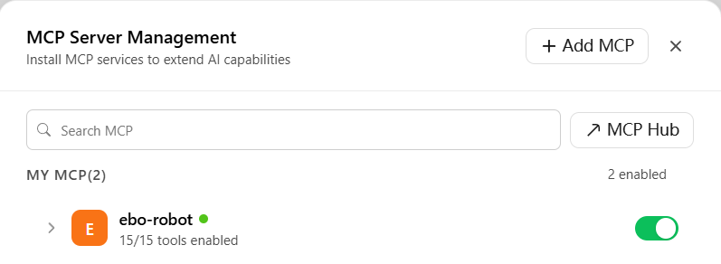

# EBO Robot MCP Tutorials

Let an AI Agent control an Enabot EBO robot in plain language — from your first successful call to three projects you can adapt.

中文 ([README.md](README.md)) · Bilingual · Runnable companion code

> **5-minute goal**: connect the robot → read its status → send your first command. Follow the [quickstart](docs/en-US/02-quickstart.md) and use the [self-check script](examples/00-connection-check/README_EN.md) to confirm real connectivity.

> **Absolute beginner?** No tech knowledge or docs needed. Copy a prompt into your AI assistant and it will walk you through connecting the robot, viewing video, and building all three projects — start with [copy-paste prompts](docs/en-US/00-copy-paste-prompts.md).



## Supported Models

| Model | MCP support | Tool capability | Projects in this repo |
| --- | --- | --- | --- |
| EBO MAX | Supported | All 15 tools | All three projects tested on this model |
| EBO Air2 Plus | Supported | 11 core tools | Not tested; see [model comparison](docs/en-US/ebo-mcp-getting-started.md#whats-the-difference-between-ebo-max-and-ebo-air2-plus) |

Other models do not support MCP yet. All screenshots and code are redacted; no real tokens, endpoints, device IDs, or LAN IPs are included.

## Three Real Projects

| Project | What it shows | Value |
| --- | --- | --- |
| [Morning Schedule Briefing](docs/en-US/project-01-morning-briefing.md) | Scheduled task + AI orchestration + multi-step control | Best entry point |
| [Smart Home Integration](docs/en-US/project-02-smart-home.md) | Python daemon + dual MCP channels | Strong engineering example |
| [Voice Assistant](docs/en-US/project-03-voice-assistant.md) | RTSP + ASR + Agent + TTS | Technical exploration |

Code lives in [examples/](examples/README.md): a connectivity check, a minimal call example, and complete scripts for all three projects.

## Language

- 中文 ([README.md](README.md))
- English (current)

## Learning Path

> **If you've never used MCP, start with [Absolute beginner: copy one prompt, let the AI walk you through it](docs/en-US/00-copy-paste-prompts.md)**. It lets your AI assistant handle connecting, audio/video, and all three projects — you don't edit config yourself. Follow the path below if you want to understand the details and do it yourself.

### ① Getting Started

1. [EBO Robot MCP Getting Started](docs/en-US/ebo-mcp-getting-started.md) — from token to natural-language control: WorkBuddy setup, example commands, model comparison, FAQ (with screenshots)
2. [Quickstart: Your First Command in 5 Minutes](docs/en-US/02-quickstart.md) — condensed version for a first successful call
3. [What is MCP](docs/en-US/01-mcp-intro.md) — protocol background, architecture, can/cannot

### ② Understanding Capabilities

4. [Tools, Resources and Prompts](docs/en-US/03-tools-resources.md) — MCP's three primitives, with EBO examples
5. [EBO MCP Tool Reference](docs/en-US/ebo-mcp-tools-reference.md) — all 15 tools, purposes, parameter tables, `moveId` chart, and calling conventions
6. [EBO Robot Control Demo](docs/en-US/04-ebo-robot-demo.md) — the natural-language-to-action chain, safety, and troubleshooting

### ③ Going Further

7. [EBO MCP Troubleshooting and Best Practices](docs/en-US/ebo-mcp-troubleshooting.md) — config issues, connection checks, sequential execution with status polling, on-site failure diagnosis, the follow-mode issue, multiple robots, A/V limits (with screenshots)
8. [Prompt Template Collection](docs/en-US/ebo-mcp-prompts.md) — field-tested templates: navigate+photo, wake-up detection, schedule broadcast, stop following, docking, multiple robots, smart-home integration

### ④ Real Projects

9. [Project 1: Morning Schedule Briefing](docs/en-US/project-01-morning-briefing.md) — runs daily at 08:00: five-step flow, state-verification polling, wake-up loop, known issues, evolution history
10. [Project 2: Smart Home Integration (Door Welcome)](docs/en-US/project-02-smart-home.md) — EBO + Mijia dual MCP channels: 8-step flow, name tri-state, core code, known issues, config parameter table
11. [Project 3: Turning EBO into a Voice Assistant](docs/en-US/project-03-voice-assistant.md) — RTSP audio + ASR + Agent bridge: three stages, wake-word phonetic matching, audio and environment constraints, why the E2E loop is still blocked

> All three projects come from systems that ran in practice, showing how to take MCP from "working" to stable long-term operation. Project 3 also records what is not yet working and why.

## Layout

```
mcp-tutorials/
├── README.md / README_EN.md      # Chinese / English entry + learning path
├── docs/
│   ├── zh-CN/ / en-US/           # 12 articles each, standalone
│   │   ├── 00-copy-paste-prompts # absolute beginner: copy prompts, let AI guide you
│   │   ├── 01~04                 # basics and control demo
│   │   ├── ebo-mcp-*             # getting started / tools / troubleshooting / prompts
│   │   └── project-01/02/03      # three real-world projects
├── assets/                       # 8 bilingual screenshots (redacted)
├── examples/
│   ├── 00-connection-check/      # Connectivity check + minimal Python call example
│   └── 01/02/03-*                # Runnable code + dependencies for 3 projects
└── LICENSE
```

## Conventions

- Keep code identifiers, commands, and MCP terms (tool / resource / prompt) in English
- One standalone article per language; no interleaved translations
- Always use placeholders for real tokens, endpoints, device IDs, and LAN IPs; all images are redacted
- Sequential-execution guidance always stresses `robot_status` verification — sent does not mean executed

## License

[MIT](LICENSE)
