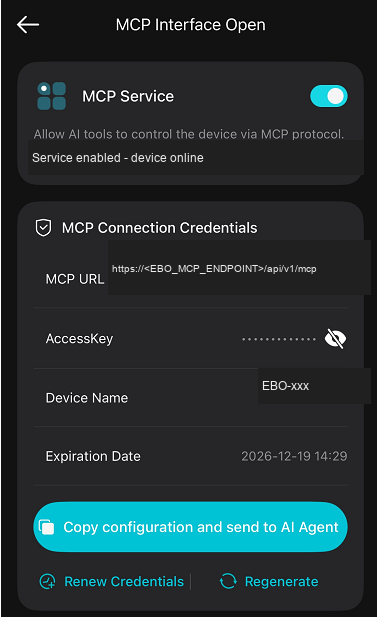
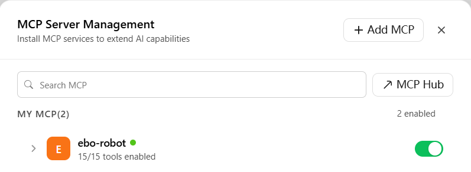

# Quickstart: Your First Command in 5 Minutes

This is the condensed version of the [full Getting Started guide](ebo-mcp-getting-started.md). It gets you to one successful run as fast as possible. For detailed steps, model comparison, and FAQ, see the full version.

## What you'll learn

- Get your MCP token
- Configure an AI Agent
- Send your first robot command

## Three steps

### 1. Get the token

Open the "Yibao Robot" app → robot settings → "AI Linked Programming", copy the MCP token, and note the MCP endpoint shown on the page.



> Tokens are valid for one month and effectively grant robot control — don't paste them into public channels. Renew in the app when expired; "Regenerate" invalidates all old tokens.

### 2. Configure the Agent

Easiest way: send the token directly to your AI Agent (Doubao / WorkBuddy / Qwen / CodeX all work) and say "help me configure this MCP" — it will guide you through its own interface. Every Agent has a different config entry; copying someone else's steps often fails.

For manual setup, Claude Desktop's config looks like this (replace both placeholders):

```json
{
  "mcpServers": {
    "ebo": {
      "type": "http",
      "url": "<EBO_MAX_MCP_ENDPOINT>/api/v1/mcp",
      "headers": { "Authorization": "Bearer <YOUR_TOKEN>" }
    }
  }
}
```

Save and fully restart the client. Seeing the MCP connection icon and 15/15 tools enabled means success.



### 3. Send a command

Just talk to the Agent in plain language:

> "Check the battery level and what the robot is doing."
> "Make the robot say: Welcome home!"
> "Take a photo so I can see what's going on at home."

## Quick troubleshooting

| Symptom | Check first |
| --- | --- |
| Can't connect | Token expired / client restarted / endpoint matches model |
| "Location not found" | Map built and location named in app; name matches exactly |
| "Stop patrol" doesn't stop follow | Say "stop all actions" → `robot_move` `moveId=5` |
| Returns OK but robot didn't move | Sent ≠ executed; verify with `robot_status` |

Full diagnosis: [Troubleshooting and Best Practices](ebo-mcp-troubleshooting.md).

## Next steps

- What can the robot actually do? → [Tool Reference](ebo-mcp-tools-reference.md)
- Want real projects? → [Project 1: Morning Briefing](project-01-morning-briefing.md), [Project 2: Smart Home](project-02-smart-home.md)
