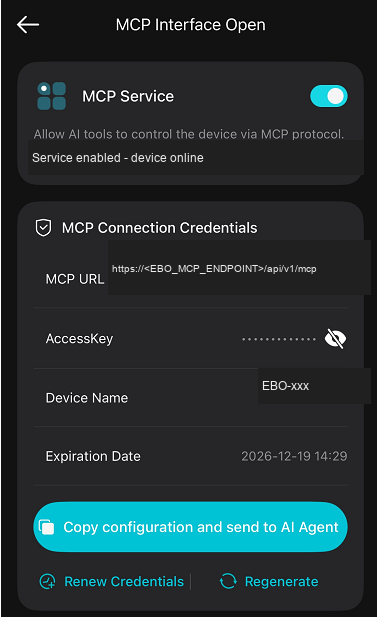
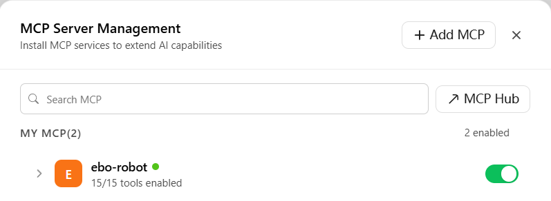

# EBO Robot MCP Getting Started

## What is this?

EBO robots now support MCP (the AI control interface). Simply put, you can use an AI assistant (such as WorkBuddy, CodeX, or other AI Agents — note that it must be an AI Agent) to control your robot in plain language, without opening the app and tapping buttons.

For example, say "go check the living room" to your AI, and it will automatically move the robot to the living room and send you a photo.

> This guide assumes you are already comfortable using an AI Agent — you know how to talk to it and assign it tasks. The exact steps below vary with the Agent you choose and the model it calls (config entry points, prompt wording, and response formats all differ), but the underlying approach is the same: configure the MCP connection → let the Agent discover the tools → call them in plain language. Once you understand the approach, you can follow it with a different Agent too.

## What you'll need

- An EBO robot. Only the EBO MAX and EBO Air2 Plus support MCP at present; other models are not supported yet. This guide and the companion projects were all tested on the EBO MAX.
- The robot powered on, connected to WiFi, and bound in the "Yibao Robot" app
- An AI Agent that supports MCP (recommendations below)

## Step 1: Get your MCP token

1. Open the "Yibao Robot" app and go to your robot's settings page
2. Find MCP Interface Access and tap it
3. You'll see an MCP token — copy and store it safely; you'll need it later



> Note: the token expires — and keep it private
> - Tokens are valid for one month. If the AI can't connect later, just tap Renew in the app.
> - If you tap Regenerate, all previously issued MCP tokens become invalid, and you'll need to reconfigure the new token in your AI Agent.
> - The token effectively grants control of your robot. Do not share it or paste it into public repositories or public tutorials.

## Step 2: Choose an AI assistant

Many AI Agents support MCP. Tested and working ones include Doubao, WorkBuddy, Qwen, and CodeX. Claude Desktop, ChatGPT Desktop, Cursor, and other mainstream tools also support MCP.

Clients differ in MCP transport, config format, and remote-connection support. The table below grades them by how thoroughly they have been verified:

| Client | Support status |
| --- | --- |
| WorkBuddy | Fully tested; this guide and all three projects were built on it |
| Doubao, Qwen, CodeX | Configurable, but specific versions and feature completeness are still being verified |
| Claude Desktop, ChatGPT Desktop, Cursor | Support MCP in principle; verify against your client version |

"Supports MCP" only means the client can load the tool list — it does not guarantee every tool works in that client. Run the [connectivity check](../../examples/00-connection-check/README_EN.md) before relying on it.

Note that every Agent has a different MCP configuration entry point and workflow — copying one tool's steps usually won't work for another. The easiest approach is to send your MCP token directly to the Agent and let it guide you through the setup; it will give you steps tailored to its own interface (see the FAQ at the end for token safety).

This guide and all three companion projects were built with WorkBuddy, so the configuration example below uses WorkBuddy too.

## Step 3: Configure the MCP connection

1. Open WorkBuddy's MCP config file at `~/.workbuddy/mcp.json` (create it if it doesn't exist)
2. Add the following to the config file, replacing two placeholders:
   - `<YOUR_TOKEN>`: the token you copied from the app
   - `<EBO_MAX_MCP_ENDPOINT>` / `<EBO_PLUS_MCP_ENDPOINT>`: the MCP endpoint for your robot. Check the MCP Interface Access page in the "Yibao Robot" app or ask official support for the address. This tutorial does not publish the concrete endpoints.

Both models use `ebo-robot` as the server name, matching what the companion code reads. Only the endpoint differs.

For EBO MAX:

```json
{
  "mcpServers": {
    "ebo-robot": {
      "type": "http",
      "url": "<EBO_MAX_MCP_ENDPOINT>/api/v1/mcp",
      "headers": {
        "Authorization": "Bearer <YOUR_TOKEN>"
      }
    }
  }
}
```

For EBO Air2 Plus:

```json
{
  "mcpServers": {
    "ebo-robot": {
      "type": "http",
      "url": "<EBO_PLUS_MCP_ENDPOINT>/api/v1/mcp",
      "headers": {
        "Authorization": "Bearer <YOUR_TOKEN>"
      }
    }
  }
}
```

3. Save the file and restart WorkBuddy
4. You'll see an MCP connection icon at the bottom of the chat box — the connection is successful (15/15 tools enabled)



## Step 4: Start chatting

Now you can control the robot in natural language. Here are some commands you can copy and try:

Check robot status

> "Check the battery level and tell me what the robot is doing."

Make the robot speak

> "Make the robot say: Welcome home!"

Move the robot to a location (requires a map built in the app first)

> "Move the robot to the doorway"
> "Move the robot to the living room"

Take a photo

> "Take a photo so I can see what's going on at home"

Record a video

> "Record a 10-second video"

Follow mode

> "Start follow mode and follow me"

Fancy moves

> "Make the robot do a spin"
> "Do a figure-eight walk"

Adjust volume

> "Set the robot volume to 50"
> "Turn the volume up a bit"

Return to charging

> "Make the robot go back to charge"

## What's the difference between EBO MAX and EBO Air2 Plus?

| Item | EBO MAX (Standard) | EBO Air2 Plus |
| --- | --- | --- |
| Number of features | All 15 features | 11 core features |
| Microphone | Four-microphone array, better pickup | Single microphone, weaker pickup than MAX |
| Camera | 2560 × 1440 | 2880 × 1620 (clearer) |
| Whole-home patrol | Supported | Not supported |
| 360-degree search | Supported | Not supported |
| Music playback | Supported | Not supported |
| Shared features | Movement, navigation, photo, video, follow, voice, volume, auto-charge (identical experience) | Same as left |

Hardware is identical between units sold in mainland China and overseas — the European version is the same as the domestic one. For voice-interaction use cases, prefer the MAX: its four-microphone array picks up sound noticeably better than the Air2 Plus's single microphone.

## FAQ

Q: Can't connect?

A: First check whether the token has expired (get a new one in the app), then check whether the AI assistant has been restarted. The config only takes effect after restarting the AI client.

Q: Navigation says "location not found"?

A: You need to build a map in the "Yibao Robot" app first and name the locations (e.g. "living room", "bedroom", "doorway"). The AI can only navigate to named locations.

Q: "Stop patrol" doesn't stop follow mode?

A: That's expected. AI follow mode is a special state — say "stop all actions" or "make the robot stop" to end it.

Q: Can I control two robots at the same time?

A: Yes. Each robot has its own token and endpoint; add one service per robot in the config. Use `ebo-robot` as the default server name; for multiple robots pick distinct names (e.g. `ebo-living`, `ebo-bedroom`), but note the companion code reads `ebo-robot` by default — change the name in the script if you use a custom one.

Q: Can I hear audio from the robot?

A: Currently MCP only supports making the robot "speak" (text-to-speech); it does not stream audio from the robot's microphone in real time. For two-way communication, use RTSP LAN video streaming for audio and video.

Q: Is it safe to send my token to an Agent to configure things?

A: The token is effectively control of your robot, and sending it to an Agent means that Agent can read it. A safer approach is to fill the token into your local `~/.workbuddy/mcp.json` yourself and let the Agent only generate the config content, never touch the real credential. Do not send tokens to untrusted third-party services or post them publicly. In either case, never put the token in code or commit it to a repository.

Q: Which languages does TTS support?

A: The built-in TTS language list includes Danish. Pass a BCP-47 language tag (e.g. `da-DK`) when calling `robot_speak`. Note this is the robot's own voice reading text aloud — MCP has no tool to play an audio file or a custom voice you generated.

Q: Does voice conversation always need an external device?

A: Yes. In the current architecture the Agent that understands your commands is the robot's "brain", and it must run continuously on a computer or server. The robot itself handles only basic actions: reporting status, executing patrols, playing sound on command. It does no understanding or reasoning on its own. This is why the voice loop in [Project 3](project-03-voice-assistant.md) needs a local always-on script.

Q: Can I receive fall-detection alerts?

A: Not through MCP. The Air2 Plus does not support fall detection. The MAX has the hardware capability but it has not been exposed to MCP yet. We can evaluate opening it up; timing still needs to be aligned with the R&D team.

Q: Which model suits a voice-companion application?

A: We recommend the EBO MAX: its four-microphone array picks up sound better, and it supports music playback (the Air2 Plus does not). Hardware is identical internationally — the European version matches the domestic one. One caveat: MCP's current purpose is to let users explore custom ideas; custom voice conversation is still at the technical-feasibility stage, with limited wake-word accuracy and noticeable latency. We will keep improving it, but cannot promise it will reach a polished product experience.
