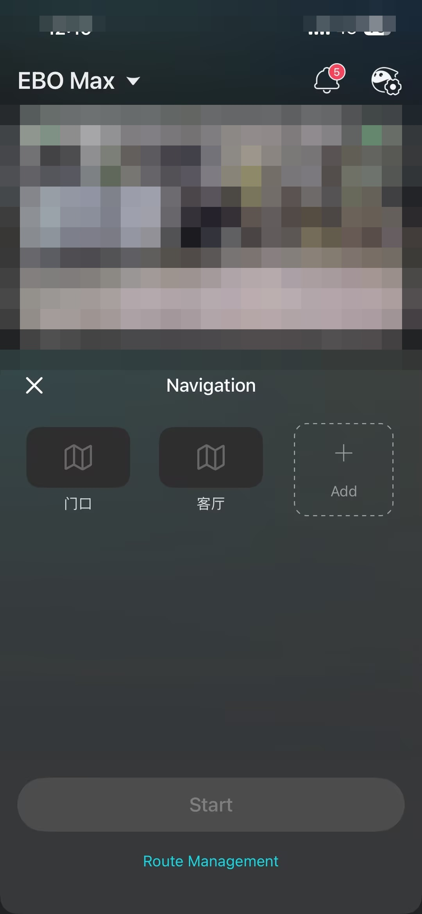
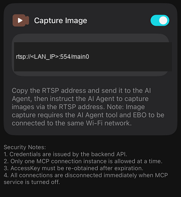

# EBO MCP Troubleshooting and Best Practices

This guide covers common pitfalls when configuring and using EBO MCP. For the basics, see the [EBO Robot MCP Getting Started](ebo-mcp-getting-started.md); for tool parameters, see the [EBO MCP Tool Reference](ebo-mcp-tools-reference.md).

## 1. Configuration

### 1.1 Invalid JSON

The config file must be valid JSON. The three most common mistakes:

- **Full-width punctuation**: quotes, commas, and colons must be half-width ASCII. Chinese quotes `“ ”` will break parsing.
- **Extra or missing commas**: no comma after the last field; commas required between fields.
- **Unreplaced placeholders**: `<YOUR_TOKEN>` and `<EBO_MAX_MCP_ENDPOINT>` are placeholders — replace them with your own values.

Validate the JSON with any JSON checker before launching the client.

### 1.2 Endpoint substitution

The endpoints in the tutorial are placeholders. When replacing them:

- Keep the `/api/v1/mcp` path — don't use the bare domain only
- If the address from the app/support already includes a path, don't append it twice
- EBO MAX and Air2 Plus use different endpoints — don't mix them up

### 1.3 Different Agents configure MCP differently

Agents tested and working include **Doubao, WorkBuddy, Qwen, and CodeX**. Their MCP configuration entry points and workflows all differ — following one agent's tutorial step-by-step often won't work for another.

**The easiest approach**: send your MCP token directly to the Agent and let it guide you through configuration. The Agent will give you steps tailored to its own interface — much faster than figuring it out from a generic tutorial.

> Note: the token effectively grants robot control. Only send it in a trusted Agent session and never to public channels.

### 1.4 Restart is required

After saving the config, **fully quit and restart** the AI client. Refreshing the window or minimizing/restoring usually does not apply the change.

## 2. Connection

### 2.1 Can't connect to the robot

Check in order:

1. Token expired (one month) — renew it in the app
2. Token was regenerated — all old tokens become invalid and old configs must be redone
3. Robot is powered on, online, and bound in the app
4. AI client was restarted
5. The endpoint matches the correct model

### 2.2 Token safety

- The token effectively grants control of your robot. Don't paste it into public repos, chats, or screenshots.
- If you suspect a leak, tap **Regenerate** in the app to invalidate the old token
- Use a separate token per robot so they can be managed and revoked independently

## 3. Usage

### 3.1 Navigation fails: "location not found"

- Mapping and naming are done in the **mobile app** — build the map and enter location names there first
- When calling MCP, the location name must match the name in the app **exactly, character for character**; otherwise navigation is intercepted
- If unsure, call `robot_list_locations` to get the exact names from the map, then pass them to `robot_navigate`
- Keep location names short, unique, and unambiguous

### 3.2 Running multiple actions in order (the big one)

This is where most pitfalls lie. Two facts to understand first:

- **No per-step completion report**: the robot does not actively tell the AI "step done" after each action
- **State is queryable**: the "device task" field in `robot_status` reflects the currently running task, so the AI can **poll status** to confirm progress

The correct pattern for sequential execution:

1. Issue one action (e.g. "go to the living room")
2. Estimate how long it takes and wait accordingly
3. Call `robot_status` and check whether "device task" is back to idle or in the state expected for the next step
4. Only after confirming the previous step finished, issue the next one

This yields a high success rate and is not blind execution. The main variable is **network conditions** — jitter delays state updates, so leave margin when polling.

**Call pacing**: do not call tools at high frequency back-to-back. Leave roughly one second or more between calls; avoid sustained high-frequency calling.

### 3.3 On-site diagnosis when an action fails

The robot currently has **no active error reporting** — failures show up as "state didn't change" or "task stuck", not a clear error. Diagnose via status queries and observation:

1. Confirm connection: send a simple command (e.g. check battery) to see if it works
2. Confirm state: call `robot_status` and inspect device task, battery, detected people count, location
3. Narrow down: split a complex command into single steps and find which one fails
4. Check the model's understanding: ask the AI to restate what it's about to do (especially the location name)
5. Record the symptoms: save the failing command, status snapshot, and actual robot behavior for review

### 3.4 Stopping follow mode (a real pitfall)

**"Stop patrol" cannot end AI follow mode.** Follow is a special state and `robot_stop_patrol` has no effect on it.

The correct way: use the **stop-all-movement** command — `robot_move` with `moveId=5` (full stop). Saying "stop all actions" or "make the robot stop" also triggers it.

> This was the most noticeable pitfall in the morning-briefing and smart-home integration projects: sending "stop patrol" while following leaves the robot still trailing the person; only "stop all movement" actually stops it.

### 3.5 Multiple robots

Each robot has its own token and endpoint. Use different server names in the config (e.g. `ebo`, `ebo-plus`) and specify which robot you mean in the command.

### 3.6 Audio/video limits

- MCP itself only supports making the robot "speak" (text-to-speech); it does not stream microphone audio in real time
- For audio/video, use the **RTSP LAN stream**: enable it in the app and an IP address will be provided. It runs over the LAN to protect user privacy
- The stream is mainly video (H.265 / H.264) with audio on a separate G.711a channel that needs separate handling

> Note: RTSP requires the AI Agent and the robot to be on the **same Wi-Fi**, and credentials are issued centrally by the backend (AP1). Only one MCP connection instance is allowed at a time. AccessKey must be re-obtained after expiration. Turning off the MCP service disconnects all sessions immediately.

## 4. Practice Examples

- **Morning schedule briefing**: have the robot announce the day's plan on a schedule — use `robot_speak` with a scheduled trigger
- **Smart-home integration**: robot actions combined with Mijia devices — involves multi-step sequential execution, so be sure to poll status to confirm each step
- The most common problems in both scenarios are the pacing of sequential execution and stopping follow mode
