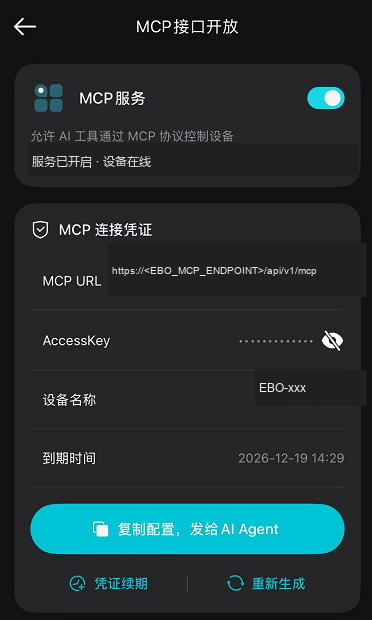
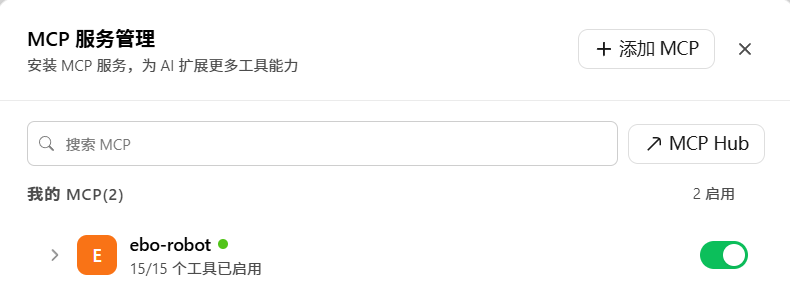

# 快速开始：5 分钟发出第一条指令

这篇是[完整入门教程](ebo-mcp-getting-started.md)的精简版，目标是让你最快跑通一次。详细步骤、机型对比和 FAQ 看完整版。

## 本文目标

- 拿到 MCP 令牌
- 配好一个 AI Agent
- 成功发出第一条机器人指令

## 三步跑通

### 1. 拿令牌

打开「一宝机器人」APP → 机器人设置 →「AI 联动编程」，复制 MCP 令牌，并记下页面显示的 MCP 地址。



> 令牌有效期一个月，等同于机器人控制权，不要贴到公开渠道。到期在 APP 内续期；点「重新生成」会让旧令牌全部失效。

### 2. 配 Agent

**最省事的办法**：把令牌直接发给你的 AI Agent（豆包 / WorkBuddy / 千问 / CodeX 均可），说"帮我配置这个 MCP"，让它按自己的界面引导你。每个 Agent 的配置入口不同，照抄别人的步骤往往行不通。

如果你想手动配，Claude Desktop 的配置文件写法如下（替换两处占位符）：

```json
{
  "mcpServers": {
    "ebo": {
      "type": "http",
      "url": "<EBO_MAX_MCP_ENDPOINT>/api/v1/mcp",
      "headers": { "Authorization": "Bearer <YOUR_TOKEN>" }
    }
  }
}
```

保存后**完全退出并重启**客户端。看到 MCP 连接图标、工具数量显示 15/15 即为成功。



### 3. 发指令

直接对 Agent 说大白话：

> 「帮我看看机器人现在电量多少，在干什么？」
> 「让机器人说：欢迎回家！」
> 「拍一张照片看看现在家里什么情况」

## 常见问题速查

| 现象 | 先检查 |
| --- | --- |
| 连不上 | 令牌是否过期 / 是否重启了客户端 / 地址是否用对机型 |
| 导航说找不到位置 | APP 里是否建图并命名了该地点；名称是否完全一致 |
| 停止巡逻停不了跟随 | 说「停止所有动作」，对应 `robot_move` 的 `moveId=5` |
| 命令返回 OK 但机器人没动 | 下发成功≠执行完成，用 `robot_status` 复核 |

完整排查见[排错与最佳实践](ebo-mcp-troubleshooting.md)。

## 下一步

- 想知道机器人到底有哪些能力？→ [工具参考](ebo-mcp-tools-reference.md)
- 想做点真实项目？→ [实战一：早间日程播报](project-01-morning-briefing.md)、[实战二：智能家居联动](project-02-smart-home.md)
