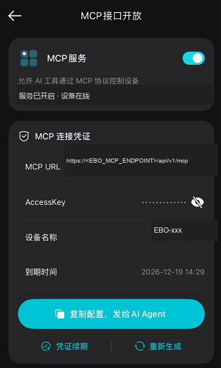
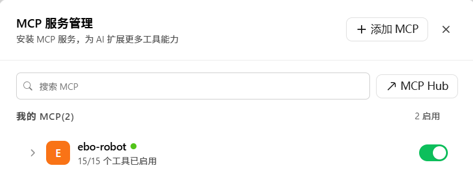

# EBO 机器人 MCP 入门教程

## 这是什么？

EBO 机器人现在支持 MCP（AI 控制接口）。你可以用 AI 助手（比如 WorkBuddy、CodeX 等 AI Agent，注意需要是 AI Agent）直接用自然语言指挥机器人，不用打开 APP 点按钮。

比如你对 AI 说「去客厅看看」，AI 就会自动让机器人走到客厅，拍张照片发给你。

> 本教程假定你已经能熟练使用一个 AI Agent——知道怎么跟它对话、怎么给它下达任务。下面的具体操作会随你选用的 Agent 和它调用的模型不同而变化（配置入口、提示词写法、返回格式都可能有差异），但背后的技术思路一致：配好 MCP 连接 → 让 Agent 发现工具 → 用自然语言调用。理解思路后，换个 Agent 也能照着做。

## 你需要准备什么

- 一台 EBO 机器人。目前仅 EBO MAX 和 EBO Air2 Plus 两款支持 MCP，其余机型暂不支持。本教程及配套项目均以 EBO MAX 实测。
- 机器人已开机、连上 WiFi，并在「一宝机器人」APP 中完成绑定
- 一个支持 MCP 的 AI Agent（下面会推荐几个）

## 第一步：获取你的 MCP 令牌

1. 打开「一宝机器人」APP，进入你的机器人设置页面
2. 找到「MCP接口开放」选项并点进去
3. 你会看到一个 MCP 令牌，复制并妥善保存，后面配置时要用到



> 注意：令牌有时效性，也不要公开
> - 令牌有效期为一个月。如果后面发现 AI 连不上机器人，在 APP 内点击续期即可。
> - 如果点击「重新生成」，则之前所有 MCP 令牌都会失效，需要用新的令牌在 AI Agent 内重新配置。
> - 令牌相当于你机器人的控制权，请勿分享或贴到公开仓库、公开教程里。

## 第二步：选择一个 AI 助手

支持 MCP 的 AI Agent 很多，实测可用的有：豆包、WorkBuddy、千问、CodeX 等。此外 Claude Desktop、ChatGPT Desktop、Cursor 等主流工具也支持 MCP。

本教程和配套的三个实战项目均使用 WorkBuddy 完成，下面的配置案例也以 WorkBuddy 为例。

不同客户端的 MCP 传输方式、配置格式和远程连接支持并不完全一致，下表按验证程度分级，供选择时参考：

| 客户端 | 支持情况 |
| --- | --- |
| WorkBuddy | 完整实测，本教程与三个项目均基于它完成 |
| 豆包、千问、CodeX | 可配置使用，具体版本与功能完整度待进一步验证 |
| Claude Desktop、ChatGPT Desktop、Cursor | 理论上支持 MCP，需按客户端版本自行验证 |

"支持 MCP"只表示客户端能加载工具，不等于所有工具都能在该客户端上跑通。实际使用前建议跑一次[连通性自检](../../examples/00-connection-check/README.md)确认。

需要提醒的是：每个 Agent 的 MCP 配置入口和流程都不一样，照抄某一种教程的步骤往往行不通。最省事的做法是——把你的 MCP 令牌直接发给 Agent，让它引导你完成配置，Agent 会按自己的界面给出对应操作步骤（令牌安全见文末常见问题）。

## 第三步：配置 MCP 连接

1. 打开 WorkBuddy 的 MCP 配置文件 `~/.workbuddy/mcp.json`（不存在就新建一个）
2. 在配置文件中添加以下内容，注意替换两处占位符：
   - `<YOUR_TOKEN>`：替换为你在 APP 中复制的令牌
   - `<EBO_MAX_MCP_ENDPOINT>` / `<EBO_PLUS_MCP_ENDPOINT>`：替换为你的机器人对应的 MCP 接入地址。具体地址请在「一宝机器人」APP 的「MCP接口开放」页面查看，或向官方获取，本教程不公开具体地址。

两款机型都用 `ebo-robot` 作为服务名，与配套代码读取的名字保持一致；区别只在接入地址。

EBO MAX 用户：

```json
{
  "mcpServers": {
    "ebo-robot": {
      "type": "http",
      "url": "<EBO_MAX_MCP_ENDPOINT>/api/v1/mcp",
      "headers": {
        "Authorization": "Bearer <YOUR_TOKEN>"
      }
    }
  }
}
```

EBO Air2 Plus 用户：

```json
{
  "mcpServers": {
    "ebo-robot": {
      "type": "http",
      "url": "<EBO_PLUS_MCP_ENDPOINT>/api/v1/mcp",
      "headers": {
        "Authorization": "Bearer <YOUR_TOKEN>"
      }
    }
  }
}
```

3. 保存文件，重启 WorkBuddy
4. 你会在对话框底部看到一个 MCP 连接图标，说明连接成功（下图显示 15/15 个工具已启用）



## 第四步：开始对话

现在你可以直接用自然语言指挥机器人了。以下是一些可以直接复制试用的指令：

查看机器人状态

> 「帮我看看机器人现在电量多少，在干什么？」

让机器人说话

> 「让机器人说：欢迎回家！」

让机器人移动到指定位置（需要先在 APP 中建图）

> 「让机器人去门口」
> 「让机器人去客厅」

让机器人拍照

> 「拍一张照片看看现在家里什么情况」

让机器人录像

> 「录一段 10 秒的视频」

让机器人跟随

> 「启动跟随模式，跟着我走」

让机器人做花式动作

> 「让机器人做一个旋转动作」
> 「来一段八字走位」

调节音量

> 「把机器人音量调到 50」
> 「音量调大一点」

让机器人回充

> 「让机器人回去充电」

## EBO MAX 和 EBO Air2 Plus 有什么区别？

| 对比项 | EBO MAX（标准版） | EBO Air2 Plus |
| --- | --- | --- |
| 功能数量 | 全部 15 个功能 | 11 个核心功能 |
| 麦克风 | 四麦克风阵列，收声更好 | 单麦克风，收声弱于 MAX |
| 摄像头 | 2560 × 1440 | 2880 × 1620（更清晰） |
| 全屋巡逻 | 支持 | 不支持 |
| 360 度搜索 | 支持 | 不支持 |
| 音乐播放 | 支持 | 不支持 |
| 共有功能 | 移动、导航、拍照、录像、跟随、语音、音量、回充（体验完全一致） | 同左 |

同一型号在中国大陆与海外销售的硬件一致，欧洲版与国内版没有差异。语音交互场景建议优先选 MAX：四麦阵列的收声效果明显好于单麦的 Air2 Plus。

## 常见问题

Q：连不上怎么办？

A：先检查令牌是否过期（回 APP 重新获取），再检查 AI 助手是否重启过。配置保存后需要重启 AI 客户端才能生效。

Q：导航说「找不到位置」？

A：你需要先在「一宝机器人」APP 中建好地图，并给各个位置命名（比如「客厅」「卧室」「门口」）。AI 只能导航到已命名的位置。

Q：「停止巡逻」停不了跟随模式？

A：这是正常的。AI 跟随模式是一种特殊状态，需要说「停止所有动作」或「让机器人停下来」才能结束。

Q：可以同时控制两台机器人吗？

A：可以。每台机器人有独立的令牌和接入地址，在配置中各加一个服务即可。默认服务名用 `ebo-robot`；多机器人时自行取不同名字区分（如 `ebo-living`、`ebo-bedroom`），但配套代码默认读 `ebo-robot`，用自定义名要同步改脚本里的服务名。

Q：能听到机器人那边的声音吗？

A：目前 MCP 只支持让机器人「说」（文字转语音），不支持实时传回机器人麦克风听到的声音。如果需要双向通话，请使用 RTSP 局域网视频流传输音视频。

Q：把令牌发给 Agent 让它帮忙配置，安全吗？

A：令牌相当于机器人的控制权，发给 Agent 意味着对方能读到它。更稳妥的做法是自己把令牌填进本地 `~/.workbuddy/mcp.json`，只让 Agent 生成配置内容、不接触真实凭据；不要把令牌发到不可信的第三方服务或贴到公开渠道。无论哪种方式，令牌都不要写进代码或提交到仓库。

Q：TTS 播报支持哪些语言？

A：内置 TTS 语言的支持列表包含丹麦语。调用 `robot_speak` 时传 BCP-47 语言标签（如 `da-DK`）即可。注意这是机器人自带音色朗读文字，MCP 没有接口播放你自己生成的音频文件或自定义音色。

Q：语音对话一定要一台外部设备吗？

A：是的。当前架构下，理解指令的 Agent 就是机器人的「大脑」，需要持续运行在一台电脑或服务器上。机器人本地只负责基本动作——上报状态、执行巡逻、按指令播放声音等。机器人本身不做理解和推理。这也是[实战三](project-03-voice-assistant.md)里语音闭环需要本地常驻脚本的原因。

Q：能接收跌倒检测的告警吗？

A：不能通过 MCP 直接接收。Air2 Plus 不支持跌倒检测；MAX 有这个硬件能力，但目前还没开放到 MCP 接口。后续会评估开放，具体时间需要和研发团队确认。

Q：哪种机型适合做语音陪伴类应用？

A：建议用 EBO MAX：四麦阵列收声更好，而且支持音乐播放（Air2 Plus 不支持）。海内外硬件一致，欧洲版与国内版没有差异。需要说明的是，MCP 目前的定位是让用户探索自定义创意的可能，自定义语音对话还在技术验证阶段，唤醒识别率和延迟都不理想，不能保证最终达到成熟产品的体验。
