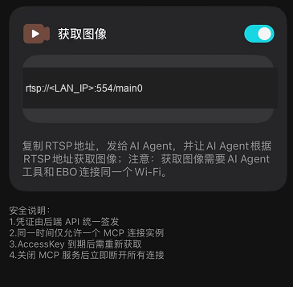

# EBO MCP 排错与最佳实践

本文汇总配置和使用 EBO MCP 时容易踩的坑，以及对应的排查思路。基础步骤见 [EBO 机器人 MCP 入门教程](ebo-mcp-getting-started.md)，工具参数见 [EBO MCP 工具参考](ebo-mcp-tools-reference.md)。

## 一、配置阶段

### 1. JSON 格式错误

配置文件必须是合法 JSON。最常见的三个错误：

- 中文标点：引号、逗号、冒号必须是英文半角符号，中文引号 `“ ”` 会导致解析失败
- 多余或缺少逗号：最后一个字段后面不能加逗号，字段之间必须有逗号
- 占位符未替换：`<YOUR_TOKEN>` 和 `<EBO_MAX_MCP_ENDPOINT>` 只是占位符，必须换成你自己的值

改完建议先用任意 JSON 校验工具确认格式，再启动客户端。

### 2. 服务地址替换

教程中的地址是占位符，替换时注意：

- 保留 `/api/v1/mcp` 路径，不要只填域名
- 如果 APP 或官方给的地址本身已带路径，不要重复拼接
- EBO MAX 与 Air2 Plus 的地址不同，别用错机型对应的地址

### 3. 不同 AI Agent 的配置方式不一样

实测可用的 Agent 包括 豆包、WorkBuddy、千问、CodeX 等。它们的 MCP 配置入口和操作流程各不相同，硬套某一种教程的配置步骤往往行不通。

最省事的做法：把你的 MCP 令牌直接发给 Agent，让它引导你完成配置 —— Agent 会按自己的界面给出对应的操作步骤。这比照着通用教程摸索更快。

> 注意：令牌等同于机器人控制权，只在可信的 Agent 会话里发送，不要贴到公开渠道。

### 4. 改完必须重启

配置保存后要完全退出并重启 AI 客户端；仅刷新窗口或最小化再打开，通常不生效。

## 二、连接阶段

### 1. 连不上机器人

按顺序排查：

1. 令牌是否过期（一个月），回 APP 续期
2. 令牌是否被「重新生成」过 —— 一旦重新生成，旧令牌全部失效，旧配置也要重配
3. 机器人是否开机、联网、已在 APP 中绑定
4. AI 客户端是否重启过
5. 服务地址是否用对了机型

### 2. 令牌安全

- 令牌等同于机器人的控制权，不要贴到公开仓库、聊天或截图里
- 怀疑泄露时，在 APP 点「重新生成」作废旧令牌
- 每台机器人用独立令牌，便于分开管理和失效

## 三、使用阶段

### 1. 导航失败：找不到位置

- 建图和命名都在手机 APP 端完成，要先建好地图并录入位置名称
- MCP 调用时地点名称必须与 APP 里录入的完全一致（一字不差），否则导航会被拦截
- 不确定的时候，先调用 `robot_list_locations` 拿到地图里的准确名字，再传给 `robot_navigate`
- 位置命名尽量简短、唯一、无歧义

### 2. 让机器人按顺序执行多个动作（核心）

这是最容易踩坑的地方。要理解两个前提：

- 没有每一步的完成回报：机器人不会在每步动作结束后主动告诉 AI「我完成了」
- 有状态可查：`robot_status` 里的「设备任务」字段反映当前正在执行的任务，AI 可以通过轮询状态来确认进度

因此，顺序执行的正确姿势是：

1. 下发一步动作（比如「去客厅」）
2. 估算这一步需要的执行时间，留出等待
3. 调用 `robot_status` 查询状态，看「设备任务」是否已恢复空闲、或是否已切换到下一步应处的状态
4. 确认上一步结束后，再下发下一步

这样可以做到较高成功率，不是完全盲跑。主要受网络环境影响 —— 网络抖动时状态更新会延迟，轮询要留足余量。

调用节奏：不要在短时间内高频连续调用工具，每次调用之间留出约 1 秒以上间隔，避免长时间高频调用。

### 3. 动作失败的现场排查

机器人目前没有运行错误的主动反馈 —— 失败往往表现为「状态没变化」或「任务卡住」，不会报一个明确的错误。所以排查要靠状态查询和观察：

1. 确认连接：先发一条简单指令（如查电量）看是否正常
2. 确认状态：调用 `robot_status`，看设备任务、电量、检测人数、所在位置
3. 缩小范围：把复杂指令拆成单步，定位是哪一步失败
4. 看模型理解：让 AI 复述它打算做什么，确认它没理解错指令（尤其是地点名）
5. 记录现象：保存失败时的指令、状态快照、机器人实际表现，便于复盘

### 4. 跟随模式的停止（实测大坑）

「停止巡逻」停不了 AI 跟随。 跟随是一种特殊状态，`robot_stop_patrol` 对它无效。

正确做法：用停止机器人所有移动的指令 —— 对应 `robot_move` 的 `moveId=5`（完全停止）。说「停止所有动作」「让机器人停下来」也能触发。

> 这是在晨间播报、智能家居联动等项目中感受最明显的坑：想结束跟随时，发「停止巡逻」机器人照样跟着人走，必须发「停止所有移动」才停得下来。

### 5. 多台机器人

每台机器人有独立的令牌和接入地址，在配置里用不同的 server 名区分（如 `ebo`、`ebo-plus`），指令里点名要控制哪台。

### 6. 音视频能力边界

- MCP 本身只支持让机器人「说」（文字转语音），不支持实时回传麦克风声音
- 需要音视频时走 RTSP 局域网视频流：在 APP 端打开开关后会给出 IP 地址，走局域网是为了保护用户隐私
- 视频流本身主要是视频（H.265 / H.264），音频是独立的 G.711a 通道，需要单独处理

> 注意：RTSP 要求 AI Agent 与机器人处于同一个 Wi-Fi，且服务由后端 AP1 统一签发；同一时间只允许一个 MCP 连接实例。AccessKey 到期后需重新获取。关闭 MCP 服务后，所有连接立即断开。

## 四、实践案例

- 晨间日程播报：让机器人按时播报当天安排 —— 适合用 `robot_speak`，配合定时任务
- 智能家居联动：机器人动作与米家等设备联动 —— 涉及多步顺序执行，务必用状态轮询确认每步完成
- 这两个场景里最容易出问题的都是：顺序执行的节奏、跟随模式的停止
